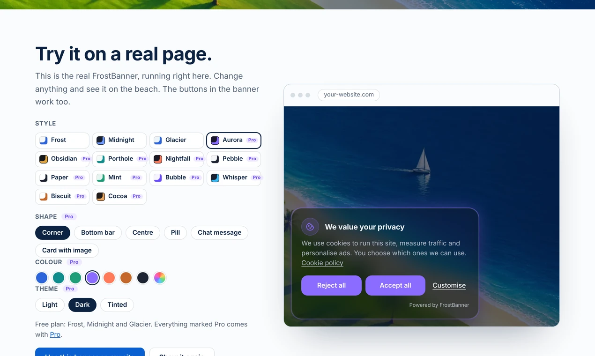
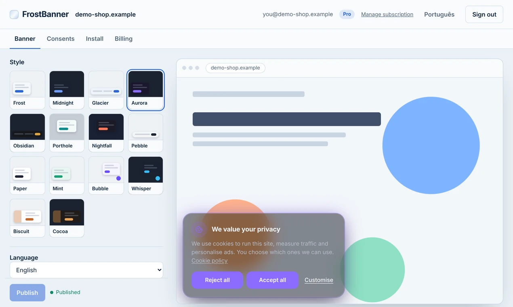

<p align="center"></p>

<h1 align="center">FrostBanner</h1>

<p align="center">
Beautiful cookie consent banners that block trackers until visitors agree.<br>
<a href="https://frostbanner.com">Website</a> · <a href="https://app.frostbanner.com/app/">Dashboard</a> · <a href="#install">Install</a> · <a href="#javascript-api">API</a>
</p>



This repository contains the source code of the **FrostBanner widget**: the script that shows the banner on your website, blocks scripts and embeds until consent and sends Google Consent Mode v2 signals. It is open so that anyone can check what it does on a visitor's device.

The hosted service at [frostbanner.com](https://frostbanner.com) adds the dashboard (style editor, texts, publishing without touching your site), the consent log with CSV export and domain verification. It has a free plan.

## Features

- **14 styles, 6 shapes** (corner card, bottom bar, centred window, pill, chat message, card with image), light, dark and tinted themes, your own colour
- **Blocks scripts until consent**: Google Analytics, Meta Pixel and anything else you mark with a category
- **Blocks YouTube, Google Maps and other iframes** until consent, with an "Allow and show" placeholder
- **Google Consent Mode v2**: `ad_storage`, `ad_user_data`, `ad_personalization`, `analytics_storage`, `functionality_storage`, `personalization_storage`
- **Equal "Accept all" and "Reject all" buttons**, granular categories, a floating button to change the choice at any time
- **Respects Global Privacy Control**: when the browser sends the GPC signal, "Accept all" leaves Marketing off (the visitor can still switch it on in the preferences; `respectGpc: false` turns this off)
- **Removes known analytics and marketing cookies** when consent is withdrawn
- Built-in texts in **29 languages** (all EU languages plus Norwegian, Catalan, Turkish, Ukrainian and Russian), all texts can be replaced
- **No dependencies**, about 60 KB minified (about 23 KB compressed), Shadow DOM (does not touch your site's CSS)
- Asks again when the set of categories changes, after `maxAgeDays`, or when you raise `consentVersion` (for example after changing your cookie policy). Text and colour edits do not ask again

## Install

Create a free account at [app.frostbanner.com](https://app.frostbanner.com/app/), add your site and paste one line into your `<head>`, before any other script:

```html
<script src="https://app.frostbanner.com/v1/fb.js" data-site="YOUR_SITE_ID"></script>
```

Style, texts, categories and language are set in the dashboard and published without touching your site again. Every decision is stored in your consent log.



## Block scripts until consent

Change the script type to `text/plain` and add its category. FrostBanner runs it only after the visitor accepts that category.

```html
<script type="text/plain" data-category="analytics"
        src="https://www.googletagmanager.com/gtag/js?id=G-XXXXXXX" async></script>
```

Inline scripts work the same way. All other attributes of the tag (`async`, `nonce`, `integrity`, `crossorigin`, `referrerpolicy`, event handlers such as `onload="init()"`) are kept on the script that runs; use `data-type` to give it a type other than `text/javascript` (for example `module`). After consent the blocked scripts run in page order: an inline script waits until the external scripts above it have loaded (at most 15 seconds, then it runs anyway and a warning is written to the console).

A script that has run cannot be unloaded. If the visitor later withdraws a category whose scripts already ran on the page, FrostBanner reloads the page so they stop (event `reload` just before). Set `reloadOnWithdraw: false` to turn this off.

## Block videos and maps until consent

Rename `src` to `data-src` and add the category:

```html
<iframe width="560" height="315" data-category="marketing"
        data-src="https://www.youtube-nocookie.com/embed/VIDEO_ID" allowfullscreen></iframe>
```

Until the visitor accepts, a placeholder with an "Allow and show" button is shown and nothing is loaded from the third party. The category must be listed in `categories`. Only `http(s)` and relative addresses are loaded.

Blocked scripts and iframes added later (single-page apps, lazy-loaded blocks) are handled the same way. Because of this, a blocked `<script type="text/plain" data-category>` that ends up in the page also runs when it comes from HTML inserted by JavaScript: if your site shows user-submitted HTML, make sure your sanitizer removes `<script>` elements whatever their `type`.

## Google Consent Mode options

FrostBanner sends the Consent Mode default (everything denied except `security_storage`) as soon as it loads, so it must be the first script in `<head>`. Optional settings go into an inline config before the FrostBanner tag (they cannot come from the dashboard: the default has to be sent before any Google tag loads):

```html
<script>
  window.frostBannerConfig = {
    consentMode: {
      waitForUpdate: 500,        // ms Google tags wait for the visitor's choice (0–10000, default 500)
      adsDataRedaction: true,    // gtag('set', 'ads_data_redaction', true)
      urlPassthrough: true,      // gtag('set', 'url_passthrough', true)
      region: ['ES', 'PT']       // deny by default only in these regions; elsewhere tags start granted
    }
  };
</script>
```

**Be careful with `region`.** Outside the listed regions Google tags start with consent granted and may set cookies before the visitor chooses — that includes EU visitors whose country you did not list. Use it only to exclude regions where consent is not required, and list every region where it is. (With Global Privacy Control the advertising keys still start denied.)

## Google Tag Manager mode

If Consent Mode is handled by the FrostBanner template in Google Tag Manager, set `gtm: true` in the inline config. FrostBanner then sends no `gtag('consent', …)` or `gtag('set', …)` commands of its own (and the `consentMode` options above are ignored), so the template is the only source of consent signals. The banner, script and iframe blocking, the consent log and all events (`change`, `shown`, …) work as usual; the `consentmode` event still fires, with `gtm: true` in its details.

```html
<script>window.frostBannerConfig = { gtm: true };</script>
<script src="https://app.frostbanner.com/v1/fb.js" data-site="YOUR_SITE_ID"></script>
```

`gtm` is read only from the inline config (the dashboard settings arrive too late to change it) and only the boolean `true` switches it on.

**Important:** with `gtm: true` FrostBanner no longer sends the "everything denied" default. The GTM template must set it, on the **Consent Initialization – All Pages** trigger, and must update it when the visitor decides. Without such a template Google tags have no consent default at all and may set cookies before the visitor chooses — do not use this mode then.

What FrostBanner provides in GTM mode for the template to read: the first-party cookie `fb_consent` (JSON with the choices in `c`, see "What is stored"), `FrostBanner.getConsent()`, and the `change` / `consentmode` events (also dispatched on `window` as `frostbanner:<name>`). It pushes nothing to `dataLayer`.

## JavaScript API

```js
FrostBanner.open();          // open the preferences
FrostBanner.getConsent();    // { necessary: true, analytics: false, ... } or null
FrostBanner.on('change', function (e) { console.log(e.choices, e.source); });
FrostBanner.reset();         // forget the choice (testing; reload the page afterwards)
FrostBanner.show();          // show the banner again (main view)
FrostBanner.configure({ template: 'midnight', accent: '#e0a33a' }); // change settings and redraw (previews)
FrostBanner.templates;       // names of the 14 built-in styles
FrostBanner.languages;       // codes of the 29 built-in languages
FrostBanner.version;         // e.g. "0.5.0"
```

Events: `change`, `consentmode`, `script`, `embed`, `log`, `shown`, `skip`, `reload`. They are also dispatched on `window` as `frostbanner:<name>`.

A link to reopen the preferences, for your footer:

```html
<a href="#" onclick="FrostBanner.open(); return false;">Cookie settings</a>
```

## What is stored on the visitor's device

One first-party cookie and the same value in local storage, both named `fb_consent`: a random consent ID, the choices, the banner version and the date. With the hosted service a cached copy of the published settings is kept in local storage (`fb_cfg_<site>`).

When the hosted service is used, each decision is sent to the consent log with the site ID, consent ID, choices, banner version, banner language, a short fingerprint of the banner texts that were shown (`text_hash`, so a record can be matched to the wording on screen) and page address. The server stores the country and a salted hash of the IP address, never the IP itself. Details: [Privacy Policy](https://frostbanner.com/privacy/) and [DPA](https://frostbanner.com/dpa/).

## Compliance

FrostBanner helps you stay GDPR-compliant: consent before tracking, equal reject option, granular categories and a record of each decision. You remain responsible for listing the cookies your site uses and for your cookie policy. FrostBanner is not legal advice and is **not** an IAB TCF / Google-certified CMP, so it is not suitable for sites that show Google AdSense or Ad Manager ads to visitors in the EEA, the UK or Switzerland.

## Security

Found a vulnerability? Please email support@frostbanner.com instead of opening a public report. See [SECURITY.md](SECURITY.md).

## Build

```bash
npm install        # once: installs the pinned terser version
npm run build      # src/fb.js -> dist/fb.min.js
```

Release check: serve the repository root (`python -m http.server 8765 --bind 127.0.0.1`) and open `http://localhost:8765/test/release-check.html`; every row must say PASS.

## License

The widget is released under the [MIT License](LICENSE). The FrostBanner hosted service, dashboard and API are not part of this repository.

Made in Porto by [Artem Galyeyev](https://automate-ai.pt). Questions: support@frostbanner.com
