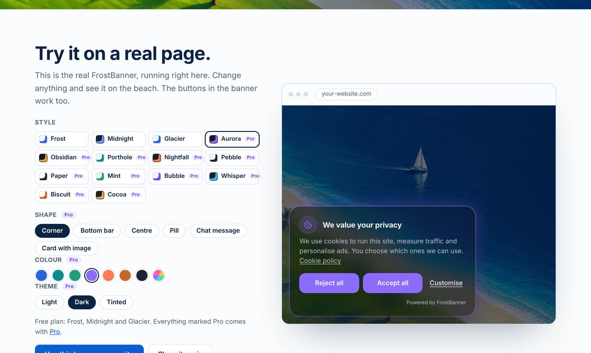

<p align="center"></p>

<h1 align="center">FrostBanner</h1>

<p align="center">
Beautiful cookie consent banners that block trackers until visitors agree.<br>
<a href="https://frostbanner.com">Website</a> · <a href="https://app.frostbanner.com/app/">Dashboard</a> · <a href="#install">Install</a> · <a href="#javascript-api">API</a>
</p>



This repository contains the source code of the **FrostBanner widget**: the script that shows the banner on your website, blocks scripts and embeds until consent and sends Google Consent Mode v2 signals. It is open so that anyone can check what it does on a visitor's device.

The hosted service at [frostbanner.com](https://frostbanner.com) adds the dashboard (style editor, texts, publishing without touching your site), the consent log with CSV export and domain verification. It has a free plan.

## Features

- **14 styles, 6 shapes** (corner card, bottom bar, centred window, pill, chat message, card with image), light, dark and tinted themes, your own colour
- **Blocks scripts until consent**: Google Analytics, Meta Pixel and anything else you mark with a category
- **Blocks YouTube, Google Maps and other iframes** until consent, with an "Allow and show" placeholder
- **Google Consent Mode v2**: `ad_storage`, `ad_user_data`, `ad_personalization`, `analytics_storage`, `functionality_storage`, `personalization_storage`
- **Equal "Accept all" and "Reject all" buttons**, granular categories, a floating button to change the choice at any time
- **Removes known analytics and marketing cookies** when consent is withdrawn
- Built-in texts in **English and Portuguese**, all texts can be replaced
- **No dependencies**, about 25 KB minified, Shadow DOM (does not touch your site's CSS)
- Asks again when the set of categories changes or after `maxAgeDays`

## Install

### With the FrostBanner dashboard (recommended)

Create a free account at [app.frostbanner.com](https://app.frostbanner.com/app/), add your site and paste one line into your `<head>`, before any other script:

```html
<script src="https://app.frostbanner.com/v1/fb.js" data-site="YOUR_SITE_ID"></script>
```

Settings published in the dashboard are loaded automatically, and every decision is stored in your consent log.

### Standalone (no account)

You can also host `dist/fb.min.js` yourself and configure it inline. Without an `endpoint` nothing is sent anywhere and no consent log is kept.

```html
<script>
  window.frostBannerConfig = {
    template: 'frost',              // frost, midnight, glacier, aurora, obsidian, porthole, nightfall,
                                    // pebble, paper, mint, bubble, whisper, biscuit, cocoa
    lang: 'en',                     // 'en' or 'pt'; null = visitor's browser language
    categories: ['necessary', 'analytics', 'marketing', 'functional'],
    policyUrl: '/cookie-policy/',
    remote: false
  };
</script>
<script src="/js/fb.min.js"></script>
```

See [`examples/index.html`](examples/index.html) for a complete page.

## Block scripts until consent

Change the script type to `text/plain` and add its category. FrostBanner runs it only after the visitor accepts that category.

```html
<script type="text/plain" data-category="analytics"
        src="https://www.googletagmanager.com/gtag/js?id=G-XXXXXXX" async></script>
```

Inline scripts work the same way.

## Block videos and maps until consent

Rename `src` to `data-src` and add the category:

```html
<iframe width="560" height="315" data-category="marketing"
        data-src="https://www.youtube-nocookie.com/embed/VIDEO_ID" allowfullscreen></iframe>
```

Until the visitor accepts, a placeholder with an "Allow and show" button is shown and nothing is loaded from the third party. The category must be listed in `categories`.

## Options

| Option | Default | Description |
| --- | --- | --- |
| `template` | `'frost'` | Visual preset |
| `layout` | from template | `corner`, `bar`, `center`, `pill`, `chat`, `split` |
| `theme` | from template | `light`, `dark`, `tint` |
| `accent` | from template | Main colour, e.g. `'#2b64d9'` |
| `radius`, `blur` | from template | Corner radius and glass blur in px |
| `glass`, `glow`, `icon` | from template | Visual switches |
| `lang` | `null` | `'en'`, `'pt'` or `null` for the browser language |
| `categories` | all four | Categories shown to the visitor (`necessary` is always on) |
| `policyUrl` | `'#'` | Link to your cookie policy |
| `texts` | `{}` | Replace any text, e.g. `{ en: { title: 'Cookies?' } }` |
| `maxAgeDays` | `180` | Ask again after this many days |
| `branding` | `true` | Show "Powered by FrostBanner" |
| `geo` | `{ mode: 'all' }` | `{ mode: 'eu' }` shows the banner only to EU/EEA visitors (needs the hosted service) |
| `container` | `null` | CSS selector to render inside an element (previews) |

## JavaScript API

```js
FrostBanner.open();          // open the preferences
FrostBanner.getConsent();    // { necessary: true, analytics: false, ... } or null
FrostBanner.on('change', function (e) { console.log(e.choices, e.source); });
FrostBanner.configure({ template: 'aurora', accent: '#8b6cff' });
FrostBanner.reset();         // forget the choice (testing)
```

Events: `change`, `consentmode`, `script`, `embed`, `log`, `shown`, `skip`. They are also dispatched on `window` as `frostbanner:<name>`.

A link to reopen the preferences, for your footer:

```html
<a href="#" onclick="FrostBanner.open(); return false;">Cookie settings</a>
```

## What is stored on the visitor's device

One first-party cookie and the same value in local storage, both named `fb_consent`: a random consent ID, the choices, the banner version and the date. With the hosted service a cached copy of the published settings is kept in local storage (`fb_cfg_<site>`).

When the hosted service is used, each decision is sent to the consent log with the site ID, consent ID, choices, banner version and page address. The server stores the country and a salted hash of the IP address, never the IP itself. Details: [Privacy Policy](https://frostbanner.com/privacy/) and [DPA](https://frostbanner.com/dpa/).

## Compliance

FrostBanner helps you stay GDPR-compliant: consent before tracking, equal reject option, granular categories and a record of each decision. You remain responsible for listing the cookies your site uses and for your cookie policy. FrostBanner is not legal advice and is **not** an IAB TCF / Google-certified CMP, so it is not suitable for sites that show Google AdSense or Ad Manager ads to visitors in the EEA, the UK or Switzerland.

## Build

```bash
npx terser src/fb.js -c -m --comments '/^!/' -o dist/fb.min.js
```

## License

The widget is released under the [MIT License](LICENSE). The FrostBanner hosted service, dashboard and API are not part of this repository.

Made in Porto by [Artem Galyeyev](https://automate-ai.pt). Questions: support@frostbanner.com
